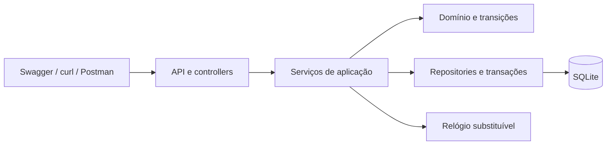

# Arquitetura planejada

Status: proposta para orientar implementação; atualizar com o código entregue.

Controllers validam entradas, traduzem erros e serializam respostas. Serviços coordenam regras e transações. Domínio contém receitas, valores e transições. Persistência controla acesso ao banco, migrações e inicialização idempotente.

Pedido, débito, consumo e estado devem ser atualizados na mesma transação. Cancelamento, troco e conclusão também devem ser indivisíveis. Atualizar preparo vencido antes de decisões dependentes do estado; consultas repetidas não podem incrementar novamente o contador. Persistir previsão de término e preço cobrado. Transações SQLite precisam de testes concorrentes com conexões independentes.

Padrões considerados: Repository para persistência; State versus enum/tabela para transições. A escolha final deve registrar problema, benefícios e custos. Não impor Strategy/Factory sem necessidade. Este diagrama ainda não comprova a entrega E04: deve ser atualizado e caber em uma página na versão final.
