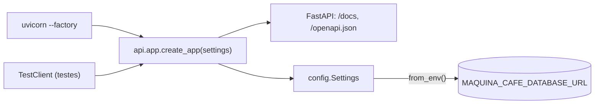
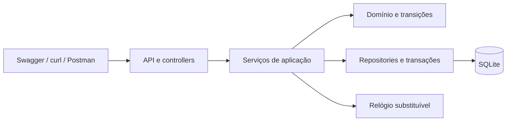

# Arquitetura

Status: atualizado em 27/11/2026 com o código da #2. A parte "Implementado" descreve o código atual; a parte "Planejado" orienta as próximas issues e deve virar código ou ser corrigida.

## Implementado (#2, #3)

- `api.app.create_app` é o ponto de composição: recebe `Settings` (ou lê do ambiente) e guarda em `app.state.settings`. As próximas issues registram aqui routers, handlers de erro (#18) e a unidade de trabalho (#4).
- `config.Settings` é imutável; `InvalidSettingsError` impede a inicialização com variável vazia.
- `services`, `domain` e `persistence` existem como pacotes vazios, com a responsabilidade descrita na docstring de cada um.
- As regras de importação entre camadas são verificadas por `tests/unit/test_architecture.py`:

| Camada | Não pode importar |
|---|---|
| `domain` | fastapi, starlette, pydantic, sqlalchemy, alembic, api, services, persistence |
| `services` | fastapi, starlette, sqlalchemy, alembic, api |
| `persistence` | fastapi, starlette, api, services |
| `api` | sqlalchemy, alembic |
| fora das camadas (`__init__`, `config`) | fastapi, starlette, sqlalchemy, alembic |

## Planejado

Controllers validam entradas, traduzem erros e serializam respostas. Serviços coordenam regras e transações. Domínio contém receitas, valores e transições. Persistência controla acesso ao banco, migrações e inicialização idempotente.

Pedido, débito, consumo e estado devem ser atualizados na mesma transação ([ADR 0002](adr/0002-persistencia-e-atomicidade.md)). Cancelamento, troco e conclusão também devem ser indivisíveis. Atualizar preparo vencido antes de decisões dependentes do estado; consultas repetidas não podem incrementar novamente o contador. Persistir previsão de término e preço cobrado. Transações SQLite precisam de testes concorrentes com conexões independentes.

Padrões: Repository e unidade de trabalho decididos no ADR 0002; State versus enum/tabela de transições a decidir na #10. Não impor Strategy/Factory sem necessidade. Este documento ainda não comprova a entrega E04: o diagrama final deve refletir o código e caber em uma página.
